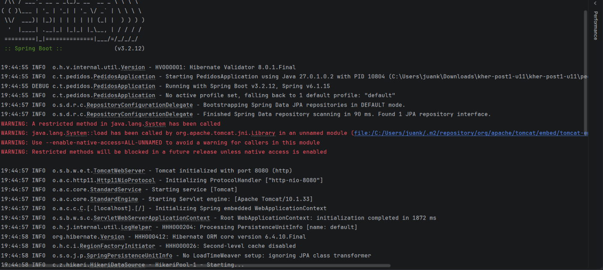
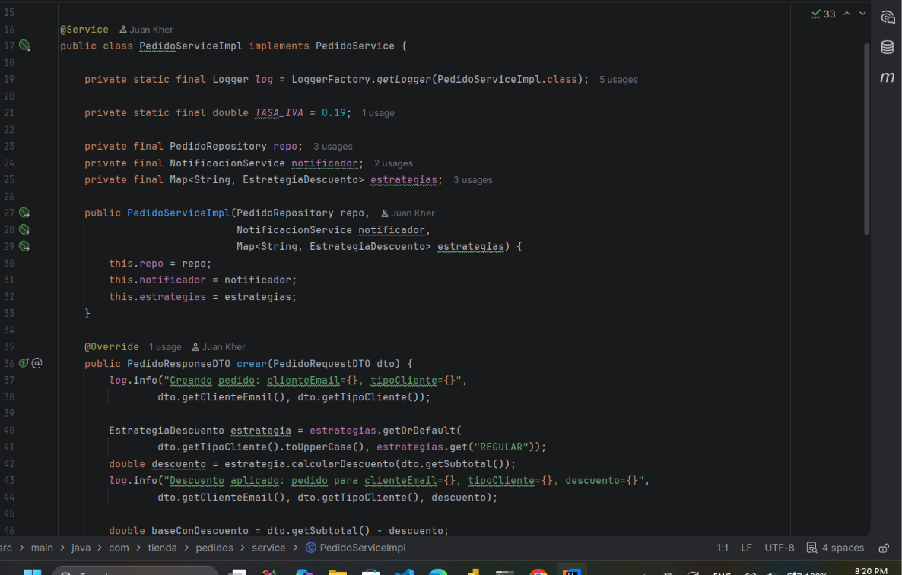
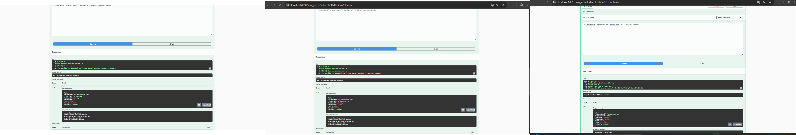
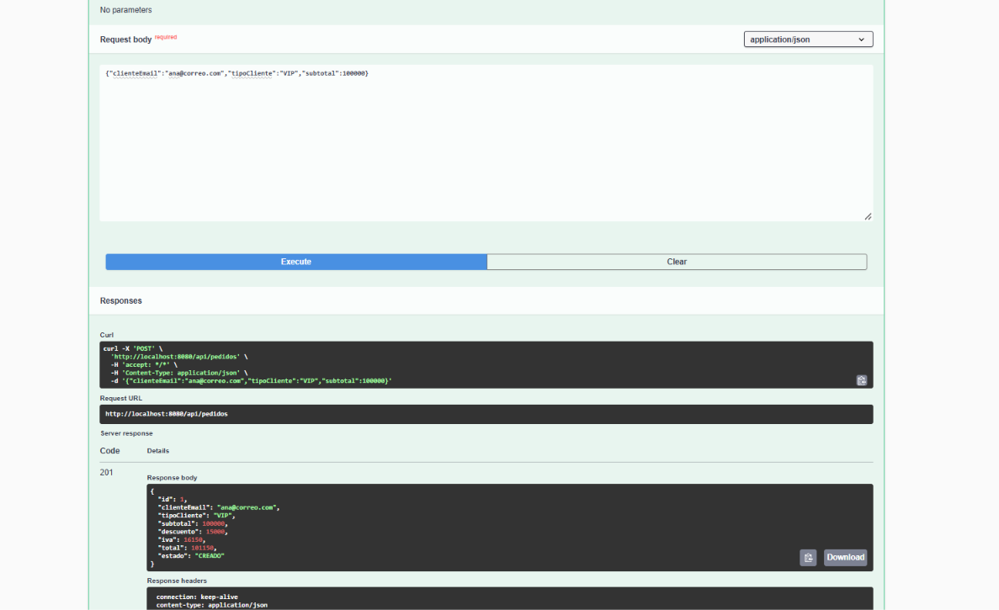
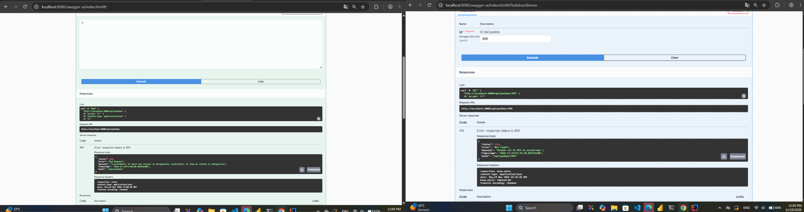
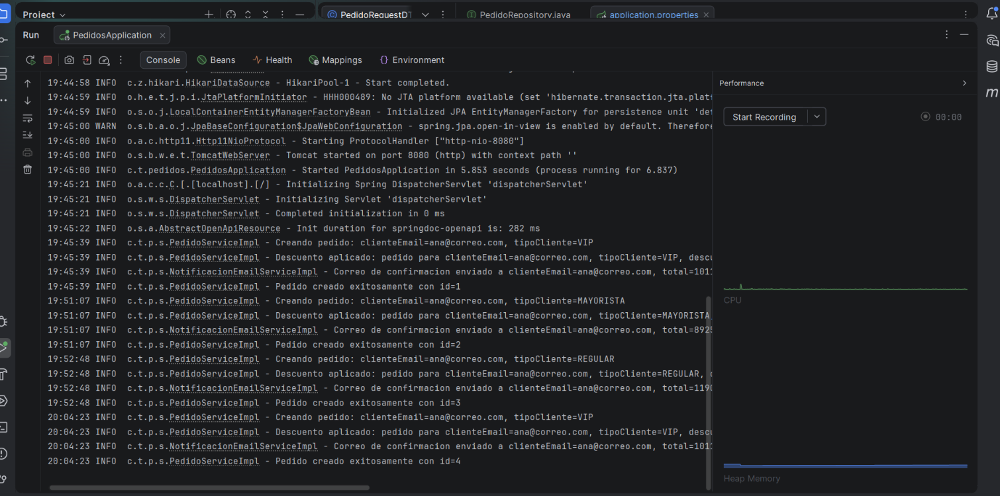
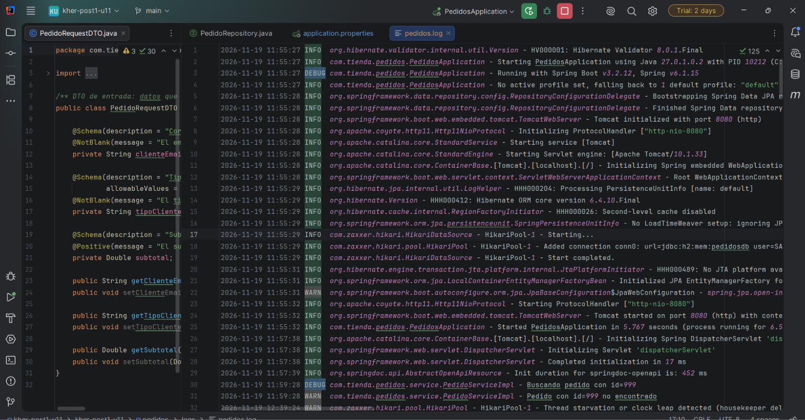
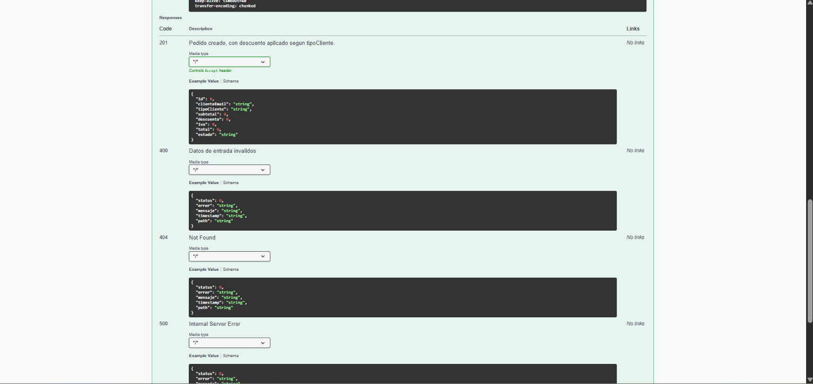

# Post-contenido — Unidad 11: Buenas Prácticas y Patrones de Diseño

## Descripción
Repositorio del laboratorio de la Unidad 11 de Programación Web — Séptimo Semestre.
Contiene un único proyecto Maven Spring Boot (`pedidos/`, paquete `com.tienda.pedidos`) que parte de un código con violaciones reales de SOLID (SRP y DIP), SQL embebido y una entidad JPA expuesta directamente en la API, y lo refactoriza aplicando arquitectura en capas, el patrón DTO, inyección de dependencias por constructor y el patrón Strategy para el descuento por tipo de cliente. Se extiende con manejo centralizado de errores, logging (SLF4J/Logback) y documentación de la API (springdoc-openapi/Swagger).

## Arquitectura resultante (diagrama de clases en texto)

```
                        HTTP (JSON)
                            │
                            ▼
┌──────────────────────────────────────────────┐
│ controller.PedidoController                  │  solo traduce HTTP ↔ servicio
└───────────────┬──────────────────────────────┘
                │ depende de la abstracción (DIP)
                ▼
┌──────────────────────────────────────────────┐
│ «interface» service.PedidoService            │
└───────────────┬──────────────────────────────┘
                │ implements
                ▼
┌──────────────────────────────────────────────┐
│ service.PedidoServiceImpl                    │  orquesta: estrategia → cálculo → persistencia → notificación
└──┬───────────────┬───────────────────┬───────┘
   │ constructor   │ constructor       │ constructor
   ▼               ▼                   ▼
«interface»     «interface»        Map<String, «interface»
repository.     service.           strategy.EstrategiaDescuento>
PedidoRepository NotificacionService      │ (llave = nombre del bean)
(JpaRepository)      ▲                    ├─ "REGULAR"   → DescuentoRegular   (0 %)
   │                 │ implements         ├─ "VIP"       → DescuentoVip       (15 %)
   ▼                 │                    └─ "MAYORISTA" → DescuentoMayorista (25 %)
entity.Pedido   NotificacionEmailServiceImpl

dto.PedidoRequestDTO  (entrada, con Bean Validation)
dto.PedidoResponseDTO (salida, SIN notasInternas)

exception.RecursoNoEncontradoException ─┐
exception.ApiError                      ├─ exception.GlobalExceptionHandler (@RestControllerAdvice)
                                        ┘   404 / 400 / 500
```

## Violaciones del código de partida y cómo se corrigió cada una

| # | Violación en el código de partida | Corrección |
|---|-----------------------------------|------------|
| 1 | **SRP**: `crearPedido` validaba, calculaba el descuento, construía el SQL, persistía, notificaba y registraba el log (6 responsabilidades). | Se repartió: validación → Bean Validation en el DTO; cálculo/orquestación → `PedidoServiceImpl`; descuento → `EstrategiaDescuento`; persistencia → `PedidoRepository`; notificación → `NotificacionService`; log → SLF4J. |
| 2 | **DIP**: `new NotificacionEmailService()` dentro del controller. | `NotificacionService` (interfaz) inyectada por constructor en `PedidoServiceImpl`; el controller depende de `PedidoService` (interfaz). No queda ningún `new` de un colaborador. |
| 3 | **Sin capa de acceso a datos**: SQL concatenado en el controller (además vulnerable a inyección SQL). | `PedidoRepository extends JpaRepository<Pedido, Long>`; no hay SQL escrito a mano. |
| 4 | **Entidad expuesta**: se devolvía `Pedido` completo, filtrando `notasInternas`. | `PedidoRequestDTO` / `PedidoResponseDTO` con mapeo explícito (`toResponseDTO`); el DTO de salida no tiene `notasInternas`. |
| 5 | **Errores dispersos**: `try/catch` con `println` y `return null` (200 vacío en vez de 404). | `RecursoNoEncontradoException` + `GlobalExceptionHandler` (`@RestControllerAdvice`): 404, 400 y 500 con cuerpo `ApiError`. |
| 6 | **`if/else if` de descuento** en el controller (cerrado a la extensión). | Patrón Strategy: un tipo nuevo (p. ej. `CORPORATIVO`) solo exige una clase nueva con `@Component("CORPORATIVO")` (OCP). |
| 7 | **`System.out.println`** como log. | SLF4J con placeholders `{}` y `logback-spring.xml` (consola + archivo rotativo). |

## Decisiones de diseño
- **`JpaRepository` en vez de `JdbcTemplate`**: elimina el SQL manual y la inyección SQL, y las consultas derivadas (`findByClienteEmail`) tienen seguridad de tipos.
- **Strategy en vez de un segundo patrón (Factory/Mapper) para el DTO**: el descuento tiene variación real de comportamiento y puede crecer (OCP); la conversión entidad→DTO es un mapeo 1:1 sin lógica condicional, así que se resuelve con un método privado del servicio y se evita la sobre-ingeniería.
- **El log del descuento vive en `PedidoServiceImpl`, no en cada Strategy**: un único punto de auditoría por pedido en lugar de tres clases dispersas.
- **`notasInternas` nunca se registra en los logs ni se expone en el DTO**: es información operativa de logística y los logs pueden compartirse con soporte o retenerse 30 días.

## Parte 1 — Refactorización con SOLID, DTO y Strategy
Se extrajeron `PedidoRepository` (DAO vía `JpaRepository`), `PedidoService`/`PedidoServiceImpl` (DIP por constructor), `PedidoRequestDTO`/`PedidoResponseDTO` (sin `notasInternas`) y el patrón Strategy (`EstrategiaDescuento` con implementaciones Regular/Vip/Mayorista) inyectado como `Map<String, EstrategiaDescuento>`.

## Parte 2 — Manejo de errores, logging y documentación
`GlobalExceptionHandler` (`@RestControllerAdvice`) maneja `RecursoNoEncontradoException` (404), `MethodArgumentNotValidException` (400) y `Exception` genérica (500). `PedidoServiceImpl` registra con SLF4J (INFO/WARN/DEBUG). `logback-spring.xml` define un appender de consola y un `RollingFileAppender` con rotación diaria y 30 días de historial en `logs/pedidos.log`. La API se documenta con springdoc-openapi (`@OpenAPIDefinition`, `@Tag`, `@Operation`, `@ApiResponse`, `@Parameter`, `@Schema`).

## Cómo compilar y ejecutar
Requisitos: Java 17+, Maven 3.9.x.

1. Clonar el repositorio: `git clone <URL-del-repo>`
2. Entrar a `pedidos/` y ejecutar `mvn spring-boot:run`
3. Probar los endpoints (ver abajo) en `http://localhost:8080/api/pedidos`
4. Consultar los logs en consola y en `pedidos/logs/pedidos.log`
5. Abrir Swagger UI en `http://localhost:8080/swagger-ui.html`

### Pruebas con curl
```bash
# 201 — VIP: descuento=15000, iva=16150, total=101150 (sin notasInternas)
curl -i -X POST localhost:8080/api/pedidos -H "Content-Type: application/json" \
  -d '{"clienteEmail":"ana@correo.com","tipoCliente":"VIP","subtotal":100000}'

# 201 — MAYORISTA: descuento=25000
curl -i -X POST localhost:8080/api/pedidos -H "Content-Type: application/json" \
  -d '{"clienteEmail":"ana@correo.com","tipoCliente":"MAYORISTA","subtotal":100000}'

# 201 — REGULAR: descuento=0
curl -i -X POST localhost:8080/api/pedidos -H "Content-Type: application/json" \
  -d '{"clienteEmail":"ana@correo.com","tipoCliente":"REGULAR","subtotal":100000}'

# 404 con ApiError
curl -i localhost:8080/api/pedidos/999

# 400 con errores de validación
curl -i -X POST localhost:8080/api/pedidos -H "Content-Type: application/json" -d '{}'
```

## Capturas de pantalla
Las imágenes van en la carpeta `capturas/` (con estos nombres):










